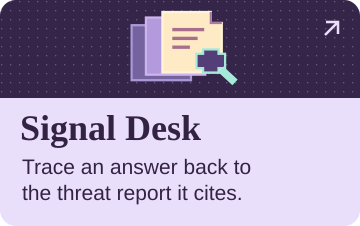
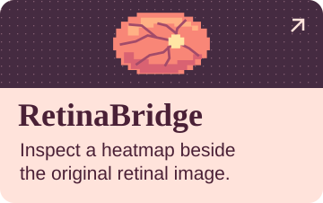
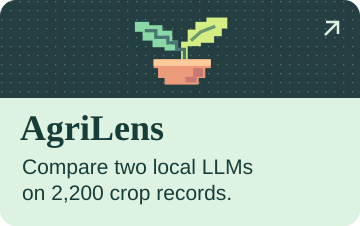
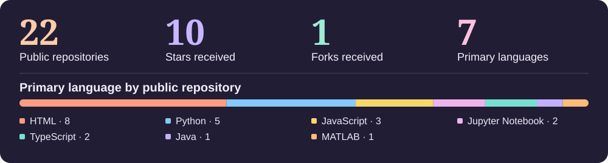

<h1>
  <picture>
    <source media="(max-width: 760px)" srcset="https://raw.githubusercontent.com/SOLANKYYY/SOLANKYYY/main/assets/studio/hero-mobile.svg?v=portrait-2">
    
  </picture>
</h1>

I’m **Om Solanki**, a B.Tech computer science and AI/ML student at Jain University in Bengaluru. When a model gives me an answer, I want to know what made it say that. I build tools that let you follow the source, inspect the image and look up the experiment for yourself.

  
  
  
  

## Featured projects

  
  
  

My field notes take you inside each build. [Follow a Signal Desk citation](https://github.com/SOLANKYYY/SOLANKYYY/blob/main/FIELDNOTES.md#signal-desk) · [Read a RetinaBridge heatmap](https://github.com/SOLANKYYY/SOLANKYYY/blob/main/FIELDNOTES.md#retinabridge) · [Reveal the crop that fooled both models](https://github.com/SOLANKYYY/SOLANKYYY/blob/main/FIELDNOTES.md#agrilens)

## GitHub stats

  
  
  

<!-- github-stats:start -->

<picture>
  <source media="(max-width: 760px)" srcset="https://raw.githubusercontent.com/SOLANKYYY/SOLANKYYY/main/assets/studio/github-stats-mobile.svg">
  
</picture>

Snapshot from GitHub on 2026-11-25. [Public repositories](https://github.com/SOLANKYYY?tab=repositories) · [Contribution calendar](https://github.com/SOLANKYYY#js-contribution-activity-description)

<!-- github-stats:end -->

## Beyond the featured projects

- **LungLens** taught me to keep the baseline. I led the student team, and our classical model outscored our CNN on the held-out CT images. We published both evaluations. [Compare the models](https://github.com/SOLANKYYY/lunglens)
- **GameArena** gave me a different kind of test. In a local load test, 50 teams signed in together and finished 1,050 arcade games with the correct final balances. [See the load test](https://github.com/SOLANKYYY/GameArena/blob/master/docs/capacity.md)
- **Flat & Fork** settles the questions flatmates actually ask. What are we eating, who’s washing up, and who can take my laundry turn today? [Explore the app](https://github.com/SOLANKYYY/flat-and-fork)

I work with **Python, MATLAB, PyTorch and ONNX Runtime** for experiments, and **Flask, Next.js, MongoDB and PostgreSQL** for the apps around them. I’m open to collaborating on applied AI, computer vision and software that makes research easier to explore. [Get in touch](mailto:om.n.solanki49@gmail.com)

## Repository directory

<strong>Machine learning and computer vision</strong> · 11 repositories

| Repository | What’s inside |
| --- | --- |
| [RetinaBridge](https://github.com/SOLANKYYY/RetinaBridge) | Retinal-image research prototype with five model grades, Grad-CAM heatmaps and a reviewer’s report. |
| [AgriLens LLM Benchmark](https://github.com/SOLANKYYY/agrilens-llm-benchmark) | Compares two local language models on the same 2,200 crop records and publishes their individual answers. |
| [LungLens](https://github.com/SOLANKYYY/lunglens) | Team project comparing a PyTorch CNN with a classical baseline on lung CT images, with results for each class. |
| [Context Lab](https://github.com/SOLANKYYY/context-lab) | Shows 15 saved Qwen responses to factual questions and questions about a supplied statement. |
| [VeraGate](https://github.com/SOLANKYYY/veragate-face-lab) | Lets you move two thresholds and see when an OpenCV face recognizer accepts, flags or rejects a match. |
| [FrameFlow](https://github.com/SOLANKYYY/frameflow-vision-lab) | Simulates frame skipping, processing delays and worker scheduling in a computer-vision pipeline. |
| [TerraSense](https://github.com/SOLANKYYY/terrasense-crop-lab) | Runs a crop classifier in the browser and compares three models on soil and climate measurements. |
| [InboxLens](https://github.com/SOLANKYYY/inboxlens-message-lab) | Classifies SMS messages locally and shows which words influence the spam score. |
| [HomeLens](https://github.com/SOLANKYYY/homelens-housing-lab) | Breaks a housing regression estimate into feature contributions using a synthetic teaching dataset. |
| [TrendScope](https://github.com/SOLANKYYY/trendscope-market-lab) | Fits trends to historical price CSVs and evaluates them on later observations. |
| [Health Predictive Analytics](https://github.com/SOLANKYYY/Health-Predictive-Analytics-using-ODE-Modeling-Machine-Learning) | Models heart-rate recovery with differential equations and explores health classification with logistic regression. |

<strong>Security and databases</strong> · 4 repositories

| Repository | What’s inside |
| --- | --- |
| [Signal Desk](https://github.com/SOLANKYYY/signal-desk) | Links public threat reports, cited chat answers and investigation notes in a Flask and MongoDB workspace. |
| [TraceLens](https://github.com/SOLANKYYY/tracelens-sysmon-lab) | Compares what survives when 384-dimensional Windows event embeddings are compressed to 2, 10 or 50 dimensions. |
| [MongoDB experiments](https://github.com/SOLANKYYY/No_Sql_Mongodb_work) | Collects 18 database labs, from document design and indexes to replication and vector search. |
| [NoSQL Lab](https://github.com/SOLANKYYY/NoSQL_Lab) | Uses Python exercises to classify database systems and match application requirements to storage models. |

<strong>Applications and portfolios</strong> · 4 repositories

| Repository | What’s inside |
| --- | --- |
| [GameArena · Hollow House](https://github.com/SOLANKYYY/GameArena) | A timed tournament arcade with seven virtual-coin games, team balances and an organizer dashboard. |
| [Flat & Fork](https://github.com/SOLANKYYY/flat-and-fork) | Helps flatmates vote on meals, split kitchen duties and hand over a laundry turn when someone is away. |
| [My Portfolio](https://github.com/SOLANKYYY/my-portfolio) | A React portfolio with project screenshots, experiment notes, education and a résumé. |
| [Interactive Portfolio](https://github.com/SOLANKYYY/solanki-portfolio-v4) | A second way to explore my projects through an isometric city and a command-line interface. |

<strong>Programming practice and profile</strong> · 3 repositories

| Repository | What’s inside |
| --- | --- |
| [LeetCode Solutions](https://github.com/SOLANKYYY/LeetCode-Solutions) | Collects my algorithm solutions across arrays, linked lists, dynamic programming and other topics. |
| [Web Boot Camp](https://github.com/SOLANKYYY/Boot_camp_1) | Early HTML exercises recreating a landing page and building a sign-up form. |
| [GitHub Profile](https://github.com/SOLANKYYY/SOLANKYYY) | Holds this profile, the project illustrations and the field notes linked above. |

