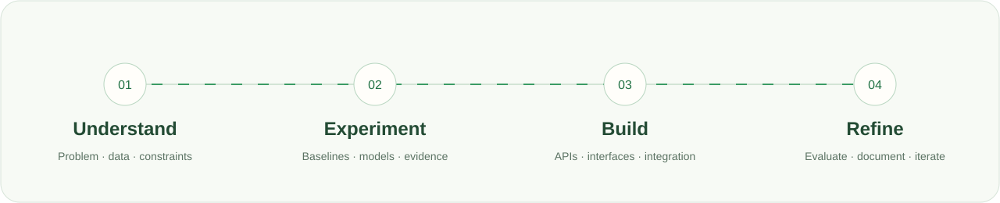

  

  <strong>Building useful software from data, models, and ideas.</strong> 
  Applied machine learning · Explainable experiments · Thoughtful interfaces

  <a href="https://solanki-portfolio-v4.vercel.app/"><strong>Portfolio ↗</strong></a> &nbsp; / &nbsp;
  <a href="https://www.linkedin.com/in/solanki-om-b89793330/">LinkedIn</a> &nbsp; / &nbsp;
  <a href="mailto:om.n.solanki49@gmail.com">Email</a> &nbsp; / &nbsp;
  <a href="https://x.com/Om_solanki49">X</a>

  <a href="#about-me">About</a> &nbsp; · &nbsp;
  <a href="#selected-projects">Projects</a> &nbsp; · &nbsp;
  <a href="#technical-toolkit">Toolkit</a> &nbsp; · &nbsp;
  <a href="#how-i-approach-a-project">Approach</a> &nbsp; · &nbsp;
  <a href="#lets-connect">Connect</a>

 

## About me

I'm **Om Solanki**, an AI/ML student based in **Bengaluru, India**, pursuing a **B.Tech in Computer Science & AI/ML at Jain University**.

I enjoy working at the intersection of machine learning and software development: understanding a dataset, experimenting with a model, and building an interface that makes the result easier to explore. My projects span computer vision, local language-model evaluation, security analytics, and web applications.

I'm especially interested in the details that make an experiment understandable: clear inputs, useful baselines, visible limitations, and results someone else can inspect. Alongside project work, I'm strengthening my foundations in data structures, algorithms, databases, and application design.

**🟢 Open to collaboration on applied AI, computer vision, and open-source projects.**

 

## What I work on

| Focus | Questions I like exploring |
| :--- | :--- |
| **Applied machine learning** | How should a model be evaluated? What do its errors reveal? How can the experiment be made reproducible? |
| **Computer vision** | How do image-processing and recognition pipelines work, and how can their decisions be made easier to inspect? |
| **Software & interfaces** | How can a technical workflow become a clear, useful application with sensible APIs and approachable controls? |

 

## Selected projects

A selection of research prototypes, interactive labs, and applications. Each repository includes more detail about its implementation and scope.

### 01 / RetinaBridge
**Retinal-imaging research, connected to a web application**

A research prototype connecting MATLAB model development with Python and ONNX inference. The application brings together patient intake, five-class diabetic retinopathy prediction, Grad-CAM visual explanations, and printable review reports.

The interesting engineering problem is the full handoff: from model development to inference, visual explanation, and a reviewable interface. The project is a research demonstration rather than a clinically validated diagnostic system.

**Built with:** MATLAB · Python · Flask · ONNX Runtime · OpenCV · JavaScript

[Source & documentation ↗](https://github.com/SOLANKYYY/RetinaBridge) · [Explore the demo ↗](https://retina-bridge.vercel.app/)

---

### 02 / Signal Desk
**A workspace for cyber threat intelligence**

A Python and Flask application for searching security reports and PDF evidence, tracking document processing, and recording analyst decisions. MongoDB supports the workspace's data, while PDF extraction makes report content available for exploration.

This project focuses on organizing information into a usable investigation workflow. Its ratings use deterministic rules, with the evidence and analyst decisions kept visible.

**Built with:** Python · Flask · MongoDB · PyMongo · pypdf · JavaScript

[Source & documentation ↗](https://github.com/SOLANKYYY/signal-desk)

---

### 03 / AgriLens LLM Benchmark
**Inspecting what local language models get right—and wrong**

A local-LLM evaluation project comparing models on the same agricultural dataset. An interactive explorer makes saved responses, errors, and per-crop results available for inspection across **2,200 records**.

The emphasis is on evaluation: comparing outputs against the data and understanding failure patterns. The browser presents recorded experiments; model runs use Ollama locally.

**Built with:** Python · Ollama · DeepSeek-R1 1.5B · Llama 3.2 3B · JavaScript

[Source & experiment results ↗](https://github.com/SOLANKYYY/agrilens-llm-benchmark)

---

### 04 / TraceLens Sysmon Lab
**Exploring event representations and classification experiments**

A research explorer comparing LDA and autoencoder compression of MiniLM embeddings for Sysmon events. It brings published experiment metrics together with an interactive lab for investigating labeling rules.

This is an exploration of representations, compression, and evaluation choices. The repository documents the heuristic labels and preprocessing limitations that shape how its results should be interpreted.

**Built with:** Python · MiniLM · LDA · Autoencoders · Logistic regression · JavaScript

[Source & research notes ↗](https://github.com/SOLANKYYY/tracelens-sysmon-lab)

---

### 05 / VeraGate Face Lab
**Making face-recognition thresholds understandable**

An interactive explanation of dual-threshold recognition decisions, enrollment steps, and boundary cases. It connects a browser-based threshold simulator with the workflow of an original Python and OpenCV LBPH prototype.

The browser lab lets visitors investigate how thresholds affect decisions. Recognition belongs to the Python prototype; the website illustrates its decision logic.

**Built with:** Python · OpenCV LBPH · Haar cascades · HTML · CSS · JavaScript

[Source & interactive lab ↗](https://github.com/SOLANKYYY/veragate-face-lab)

---

### 06 / LungLens
**An educational imaging and inference workspace**

An imaging dashboard with a local Python inference API, a reproducible NumPy baseline, and documented training and evaluation workflows.

The included baseline learns synthetic visual patterns. That makes it useful for exploring the application and inference pipeline while keeping its scope clear: it is an educational prototype, not a trained lung-cancer classifier.

**Built with:** Python · NumPy · Pillow · HTML · CSS · JavaScript

[Source & model workflow ↗](https://github.com/SOLANKYYY/lunglens)

<strong>More experiments to explore</strong>

 

- [Health Predictive Analytics](https://github.com/SOLANKYYY/Health-Predictive-Analytics-using-ODE-Modeling-Machine-Learning) — ODE modeling and machine learning for health analytics.
- [TerraSense Crop Lab](https://github.com/SOLANKYYY/terrasense-crop-lab) — Crop recommendation experiments.
- [AI Timetable Generator](https://github.com/SOLANKYYY/ai-timetable-generator) — An interface for academic scheduling.
- [LeetCode Solutions](https://github.com/SOLANKYYY/LeetCode-Solutions) — Data structures and algorithms practice.

 

## Technical toolkit

The languages, frameworks, and tools I use and explore across coursework and projects.

| Area | Technologies |
| :--- | :--- |
| **Languages** | Python · Java · JavaScript · HTML · CSS |
| **Machine learning** | PyTorch · TensorFlow · Keras · scikit-learn · MLflow |
| **Vision & inference** | OpenCV · ONNX Runtime · MATLAB · Pillow |
| **Data & visualization** | NumPy · Pandas · SciPy · Matplotlib · Plotly |
| **Web & APIs** | Flask · FastAPI · React · Next.js · Node.js |
| **UI development** | Tailwind CSS · Bootstrap · Figma |
| **Databases & infrastructure** | PostgreSQL · MySQL · MongoDB · Firebase · Docker |
| **Local LLM experiments** | Ollama · Prompt evaluation · Response analysis |

 

## How I approach a project

  

1. **Start with the question.** Understand the problem, the available data, and the constraints before choosing a model or framework.
2. **Make the experiment inspectable.** Establish a baseline, compare results, and look at errors as well as headline metrics.
3. **Connect the pieces.** Bring together data processing, inference or application logic, APIs, and an interface people can explore.
4. **Document and improve.** Explain setup, assumptions, and limitations, then use what the project reveals to guide the next iteration.

These are the habits I'm working to strengthen with each project.

 

## Currently exploring

- **Model evaluation:** better baselines, error analysis, and reproducible comparisons.
- **Computer vision:** inference pipelines, visual explanations, and understandable decision boundaries.
- **Software foundations:** data structures, algorithms, databases, and clear API design.
- **Application development:** turning individual experiments into coherent, documented user workflows.

 

## The contribution trail

Small iterations add up. Here's a moving view of my GitHub contribution graph.

  

  <a href="https://github.com/SOLANKYYY?tab=repositories">Browse all repositories ↗</a> &nbsp; · &nbsp;
  <a href="https://github.com/SOLANKYYY?tab=overview">View contribution activity ↗</a>

 

## Let's connect

I'm interested in collaborating on **applied ML experiments, computer-vision prototypes, useful web applications, and open-source improvements**. I enjoy projects with a clear problem to investigate and room to learn through building.

Have an idea, a question about a repository, or a thoughtful suggestion? I'd be glad to hear from you.

**🟢 Open to collaboration** · Bengaluru, India

[Email me](mailto:om.n.solanki49@gmail.com) · [Connect on LinkedIn](https://www.linkedin.com/in/solanki-om-b89793330/) · [Visit my portfolio](https://solanki-portfolio-v4.vercel.app/) · [Find me on X](https://x.com/Om_solanki49)

 

  

