# Om Solanki

I’m a computer science and AI/ML undergraduate at Jain University in Bengaluru. When a model gives me an answer, my next question is usually “What made it say that?” I build tools that let you open the source passage, inspect the image or read the model’s original reply.

I also build things I’d use with friends, including a tournament arcade and an app for settling whose turn it is to do the dishes.

[Portfolio](https://solanki-portfolio-v4.vercel.app/) · [LinkedIn](https://www.linkedin.com/in/solanki-om-b89793330/) · [Email](mailto:om.n.solanki49@gmail.com) · [All repositories](#repository-directory)

## Three projects to start with

<a href="https://github.com/SOLANKYYY/SOLANKYYY/blob/main/FIELDNOTES.md">
  <picture>
    <source media="(max-width: 760px)" srcset="https://raw.githubusercontent.com/SOLANKYYY/SOLANKYYY/main/assets/studio/hero-mobile.svg?v=fieldnotes-1">
    
  </picture>
</a>

**[Signal Desk](https://github.com/SOLANKYYY/signal-desk)** lets you ask a question about a public threat report and follow the citation back to the passage the assistant used. The retrieval code and its tests are public, so you can trace an answer without signing in.

**[RetinaBridge](https://github.com/SOLANKYYY/RetinaBridge)** puts a fundus photograph, its enhanced version and a Grad-CAM heatmap side by side. The research prototype takes a retinal-image model trained in MATLAB and runs it on the web with ONNX Runtime.

**[AgriLens LLM Benchmark](https://github.com/SOLANKYYY/agrilens-llm-benchmark)** gives DeepSeek and Llama the same seven soil and weather measurements. On the first record, one picked apple and the other picked pigeon peas. I kept both answers, their explanations and the dataset label.

[Open my field notes and reveal the crop →](https://github.com/SOLANKYYY/SOLANKYYY/blob/main/FIELDNOTES.md#agrilens)

## Building with other people

I led the student team behind **LungLens**. A classical baseline outscored our CNN on the held-out CT images, so we published both results. The confusion matrix shows which image classes gave the CNN trouble. [Compare the models](https://github.com/SOLANKYYY/lunglens)

I use Next.js and PostgreSQL when a project has to keep people in sync. In **GameArena**, 50 teams signed in together and finished 1,050 games in a local load test. In **Flat & Fork**, a flatmate can hand over today’s laundry without changing next week’s rotation. [GameArena test report](https://github.com/SOLANKYYY/GameArena/blob/master/docs/capacity.md) · [Flat & Fork handover rules](https://github.com/SOLANKYYY/flat-and-fork/blob/main/MOBILE-PROFILES-HANDOVER.md)

I’m open to collaborating on computer vision, language-model evaluation and web tools that make experiments easier to explore. [Get in touch](mailto:om.n.solanki49@gmail.com)

## Repository directory

### Machine learning and computer vision

| Repository | What’s inside |
| --- | --- |
| [RetinaBridge](https://github.com/SOLANKYYY/RetinaBridge) | Retinal-image research prototype with five model grades, Grad-CAM heatmaps and a reviewer’s report. |
| [AgriLens LLM Benchmark](https://github.com/SOLANKYYY/agrilens-llm-benchmark) | Compares two local language models on the same 2,200 crop records and publishes their individual answers. |
| [LungLens](https://github.com/SOLANKYYY/lunglens) | Team project comparing a PyTorch CNN with a classical baseline on lung CT images, with results for each class. |
| [Context Lab](https://github.com/SOLANKYYY/context-lab) | Shows 15 saved Qwen responses to factual questions and questions about a supplied statement. |
| [VeraGate](https://github.com/SOLANKYYY/veragate-face-lab) | Lets you move two thresholds and see when an OpenCV face recognizer accepts, flags or rejects a match. |
| [FrameFlow](https://github.com/SOLANKYYY/frameflow-vision-lab) | Simulates frame skipping, processing delays and worker scheduling in a computer-vision pipeline. |
| [TerraSense](https://github.com/SOLANKYYY/terrasense-crop-lab) | Runs a crop classifier in the browser and compares three models on soil and climate measurements. |
| [InboxLens](https://github.com/SOLANKYYY/inboxlens-message-lab) | Classifies SMS messages locally and shows which words influence the spam score. |
| [HomeLens](https://github.com/SOLANKYYY/homelens-housing-lab) | Breaks a housing regression estimate into feature contributions using a synthetic teaching dataset. |
| [TrendScope](https://github.com/SOLANKYYY/trendscope-market-lab) | Fits trends to historical price CSVs and evaluates them on later observations. |
| [Health Predictive Analytics](https://github.com/SOLANKYYY/Health-Predictive-Analytics-using-ODE-Modeling-Machine-Learning) | Models heart-rate recovery with differential equations and explores health classification with logistic regression. |

### Security and databases

| Repository | What’s inside |
| --- | --- |
| [Signal Desk](https://github.com/SOLANKYYY/signal-desk) | Links public threat reports, cited chat answers and investigation notes in a Flask and MongoDB workspace. |
| [TraceLens](https://github.com/SOLANKYYY/tracelens-sysmon-lab) | Compares what survives when 384-dimensional Windows event embeddings are compressed to 2, 10 or 50 dimensions. |
| [MongoDB experiments](https://github.com/SOLANKYYY/No_Sql_Mongodb_work) | Collects 18 database labs, from document design and indexes to replication and vector search. |
| [NoSQL Lab](https://github.com/SOLANKYYY/NoSQL_Lab) | Uses Python exercises to classify database systems and match application requirements to storage models. |

### Applications and portfolios

| Repository | What’s inside |
| --- | --- |
| [GameArena · Hollow House](https://github.com/SOLANKYYY/GameArena) | A timed tournament arcade with seven virtual-coin games, team balances and an organizer dashboard. |
| [Flat & Fork](https://github.com/SOLANKYYY/flat-and-fork) | Helps flatmates vote on meals, split kitchen duties and hand over a laundry turn when someone is away. |
| [My Portfolio](https://github.com/SOLANKYYY/my-portfolio) | A React portfolio with project screenshots, experiment notes, education and a résumé. |
| [Interactive Portfolio](https://github.com/SOLANKYYY/solanki-portfolio-v4) | A second way to explore my projects through an isometric city and a command-line interface. |

### Programming practice and profile

| Repository | What’s inside |
| --- | --- |
| [LeetCode Solutions](https://github.com/SOLANKYYY/LeetCode-Solutions) | Collects my algorithm solutions across arrays, linked lists, dynamic programming and other topics. |
| [Web Boot Camp](https://github.com/SOLANKYYY/Boot_camp_1) | Early HTML exercises recreating a landing page and building a sign-up form. |
| [GitHub Profile](https://github.com/SOLANKYYY/SOLANKYYY) | Holds this profile, the project illustrations and the field notes linked above. |
