<picture>
  <source media="(max-width: 600px)" srcset="assets/pastel/hero-mobile.svg">
  
</picture>

  <a href="https://solanki-portfolio-v4.vercel.app/"></a>
  <a href="https://www.linkedin.com/in/solanki-om-b89793330/"></a>
  <a href="mailto:om.n.solanki49@gmail.com"></a>
  

<a href="PROFILE.md">Read the complete profile in text</a>

<picture>
  <source media="(max-width: 600px)" srcset="assets/pastel/about-mobile.svg">
  
</picture>

<picture>
  <source media="(max-width: 600px)" srcset="assets/pastel/focus-mobile.svg">
  
</picture>

<a href="https://github.com/SOLANKYYY/RetinaBridge">
<picture>
  <source media="(max-width: 600px)" srcset="assets/pastel/project-1-mobile.svg">
  
</picture>
</a>

<a href="https://retina-bridge.vercel.app/">Explore the RetinaBridge demonstration ↗</a>

<a href="https://github.com/SOLANKYYY/signal-desk">
<picture>
  <source media="(max-width: 600px)" srcset="assets/pastel/project-2-mobile.svg">
  
</picture>
</a>

<a href="https://github.com/SOLANKYYY/agrilens-llm-benchmark">
<picture>
  <source media="(max-width: 600px)" srcset="assets/pastel/project-3-mobile.svg">
  
</picture>
</a>

<a href="https://github.com/SOLANKYYY/tracelens-sysmon-lab">
<picture>
  <source media="(max-width: 600px)" srcset="assets/pastel/project-4-mobile.svg">
  
</picture>
</a>

<a href="https://github.com/SOLANKYYY/veragate-face-lab">
<picture>
  <source media="(max-width: 600px)" srcset="assets/pastel/project-5-mobile.svg">
  
</picture>
</a>

<a href="https://github.com/SOLANKYYY/lunglens">
<picture>
  <source media="(max-width: 600px)" srcset="assets/pastel/project-6-mobile.svg">
  
</picture>
</a>

<strong>More experiments to explore</strong>

- [Health Predictive Analytics](https://github.com/SOLANKYYY/Health-Predictive-Analytics-using-ODE-Modeling-Machine-Learning) — ODE modeling and machine learning for health analytics.
- [TerraSense Crop Lab](https://github.com/SOLANKYYY/terrasense-crop-lab) — Crop recommendation experiments.
- [AI Timetable Generator](https://github.com/SOLANKYYY/ai-timetable-generator) — An interface for academic scheduling.
- [LeetCode Solutions](https://github.com/SOLANKYYY/LeetCode-Solutions) — Data structures and algorithms practice.

<picture>
  <source media="(max-width: 600px)" srcset="assets/pastel/toolkit-mobile.svg">
  
</picture>

<picture>
  <source media="(max-width: 600px)" srcset="assets/pastel/approach-mobile.svg">
  
</picture>

<picture>
  <source media="(max-width: 600px)" srcset="assets/pastel/learning-mobile.svg">
  
</picture>

<picture>
  <source media="(max-width: 600px)" srcset="assets/pastel/exploring-mobile.svg">
  
</picture>

<picture>
  <source media="(max-width: 600px)" srcset="assets/pastel/contributions-mobile.svg">
  
</picture>

<a href="https://github.com/SOLANKYYY?tab=repositories">Browse all repositories ↗</a>

<picture>
  <source media="(max-width: 600px)" srcset="assets/pastel/connect-mobile.svg">
  
</picture>

  
  
  
  

<picture>
  <source media="(max-width: 600px)" srcset="assets/pastel/footer-mobile.svg">
  
</picture>
