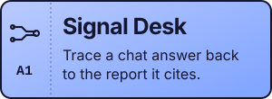
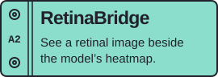
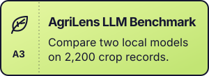
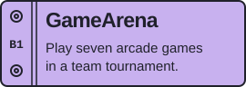
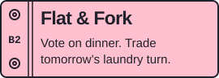
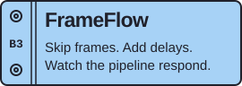

<h1>
  <picture>
    <source media="(max-width: 760px)" srcset="https://raw.githubusercontent.com/SOLANKYYY/SOLANKYYY/main/assets/mixtape/cover-mobile.svg">
    
  </picture>
</h1>

I’m **Om Solanki**, a B.Tech computer science and AI/ML student at Jain University in Bengaluru. I write Python and MATLAB to see what models pick up, then build web apps people can try. Sometimes that means tracing a prediction back to an image. Sometimes it means settling who’s on laundry duty or keeping score in a seven-game arcade.

The duck in the headphones reviews my code. Excellent listener. Suspiciously few comments.

[Portfolio](https://solanki-portfolio-v4.vercel.app/) · [LinkedIn](https://www.linkedin.com/in/solanki-om-b89793330/) · [Email](mailto:om.n.solanki49@gmail.com) · [X](https://x.com/Om_solanki49)

## Six projects on rotation

  
  
  
  
  
  

For the stories behind Side A, follow a Signal Desk citation, inspect a RetinaBridge heatmap, or meet the crop that fooled both language models. [Read the field notes](https://github.com/SOLANKYYY/SOLANKYYY/blob/main/FIELDNOTES.md)

## GitHub activity

<!-- live-profile-stats -->

<picture>
  <source media="(max-width: 760px)" srcset="https://solankyyy-profile-mixtape.vercel.app/api/activity?view=activity&amp;layout=mobile">
  
</picture>

The streak and weekly grid use days with GitHub contributions. The bars count my authored commits on the default branches of my public repositories. Each chart shows its latest complete UTC day.

[Read the current numbers](https://solankyyy-profile-mixtape.vercel.app/api/activity?view=text) · [Open my contribution calendar](https://github.com/SOLANKYYY#js-contribution-activity-description) · [Browse my public commits](https://github.com/search?q=author%3ASOLANKYYY+user%3ASOLANKYYY+is%3Apublic&type=commits)

Repository totals and languages

<picture>
  <source media="(max-width: 760px)" srcset="https://solankyyy-profile-mixtape.vercel.app/api/activity?view=totals&amp;layout=mobile">
  
</picture>

I work with **Python, MATLAB, PyTorch and ONNX Runtime** for experiments, and **Flask, Next.js, MongoDB and PostgreSQL** for the apps around them. I’m open to building things together, especially applied AI, tools for exploring data, and games. [Get in touch](mailto:om.n.solanki49@gmail.com)

## Repository directory

<strong>Machine learning and computer vision</strong> · 11 repositories

| Repository | What’s inside |
| --- | --- |
| [RetinaBridge](https://github.com/SOLANKYYY/RetinaBridge) | Retinal-image research prototype with five model grades, Grad-CAM heatmaps and a reviewer’s report. |
| [AgriLens LLM Benchmark](https://github.com/SOLANKYYY/agrilens-llm-benchmark) | Compares two local language models on the same 2,200 crop records and publishes their individual answers. |
| [LungLens](https://github.com/SOLANKYYY/lunglens) | Team project comparing a PyTorch CNN with a classical baseline on lung CT images, with results for each class. |
| [Context Lab](https://github.com/SOLANKYYY/context-lab) | Shows 15 saved Qwen responses to factual questions and questions about a supplied statement. |
| [VeraGate](https://github.com/SOLANKYYY/veragate-face-lab) | Lets you move two thresholds and see when an OpenCV face recognizer accepts, flags or rejects a match. |
| [FrameFlow](https://github.com/SOLANKYYY/frameflow-vision-lab) | Simulates frame skipping, processing delays and worker scheduling in a computer-vision pipeline. |
| [TerraSense](https://github.com/SOLANKYYY/terrasense-crop-lab) | Runs a crop classifier in the browser and compares three models on soil and climate measurements. |
| [InboxLens](https://github.com/SOLANKYYY/inboxlens-message-lab) | Classifies SMS messages locally and shows which words influence the spam score. |
| [HomeLens](https://github.com/SOLANKYYY/homelens-housing-lab) | Breaks a housing regression estimate into feature contributions using a synthetic teaching dataset. |
| [TrendScope](https://github.com/SOLANKYYY/trendscope-market-lab) | Fits trends to historical price CSVs and evaluates them on later observations. |
| [Health Predictive Analytics](https://github.com/SOLANKYYY/Health-Predictive-Analytics-using-ODE-Modeling-Machine-Learning) | Models heart-rate recovery with differential equations and explores health classification with logistic regression. |

<strong>Security and databases</strong> · 4 repositories

| Repository | What’s inside |
| --- | --- |
| [Signal Desk](https://github.com/SOLANKYYY/signal-desk) | Links public threat reports, cited chat answers and investigation notes in a Flask and MongoDB workspace. |
| [TraceLens](https://github.com/SOLANKYYY/tracelens-sysmon-lab) | Compares what survives when 384-dimensional Windows event embeddings are compressed to 2, 10 or 50 dimensions. |
| [MongoDB experiments](https://github.com/SOLANKYYY/No_Sql_Mongodb_work) | Collects 18 database labs, from document design and indexes to replication and vector search. |
| [NoSQL Lab](https://github.com/SOLANKYYY/NoSQL_Lab) | Uses Python exercises to classify database systems and match application requirements to storage models. |

<strong>Applications and portfolios</strong> · 4 repositories

| Repository | What’s inside |
| --- | --- |
| [GameArena · Hollow House](https://github.com/SOLANKYYY/GameArena) | A timed tournament arcade with seven virtual-coin games, team balances and an organizer dashboard. |
| [Flat & Fork](https://github.com/SOLANKYYY/flat-and-fork) | Helps flatmates vote on meals, split kitchen duties and hand over a laundry turn when someone is away. |
| [My Portfolio](https://github.com/SOLANKYYY/my-portfolio) | A React portfolio with project screenshots, experiment notes, education and a résumé. |
| [Interactive Portfolio](https://github.com/SOLANKYYY/solanki-portfolio-v4) | A second way to explore my projects through an isometric city and a command-line interface. |

<strong>Programming practice and profile</strong> · 3 repositories

| Repository | What’s inside |
| --- | --- |
| [LeetCode Solutions](https://github.com/SOLANKYYY/LeetCode-Solutions) | Collects my algorithm solutions across arrays, linked lists, dynamic programming and other topics. |
| [Web Boot Camp](https://github.com/SOLANKYYY/Boot_camp_1) | Early HTML exercises recreating a landing page and building a sign-up form. |
| [GitHub Profile](https://github.com/SOLANKYYY/SOLANKYYY) | Holds the animated mixtape, the public GitHub stats renderer and notes from three builds. |

